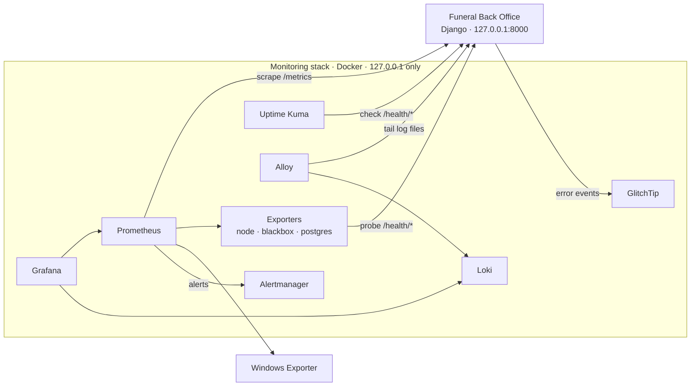

# Application Monitoring Platform

A standalone, open-source technical monitoring platform. The first application it will monitor is the **Funeral Back Office System** (a Django application).

**Current phase:** Phase 5 (production readiness) is complete and tested locally. Production deployment is waiting for a server, domains and SMTP details; see [docs/deployment.md](docs/deployment.md) and [docs/security-review.md](docs/security-review.md).

| Service | URL (local only) | Purpose |
|---|---|---|
| Grafana OSS 13.3.2 | http://localhost:3000 | Dashboards: *Application Overview* and *Monitoring Platform Health* |
| Uptime Kuma 2.5.12 | http://localhost:3001 | Availability checks |
| Prometheus v3.16.0 | http://localhost:9090 | Metrics collection, storage and alert rules |
| Alertmanager v0.35.1 | http://localhost:9093 | Alert grouping, deduplication and suppression. No notifications are configured. |
| GlitchTip 6.2.6 | http://localhost:8001 | Exception tracking (Sentry-compatible) |
| Loki 3.7.10 | http://localhost:3100 (API only) | Log storage. Browse it in Grafana under Explore or the dashboard's Logs section. |
| Alloy v1.22.0 | internal only | Ships the app's JSON log files to Loki |
| Node / Blackbox / PostgreSQL exporters | internal only | Docker host metrics, endpoint and TLS probes, and GlitchTip DB metrics |
| Windows Exporter v0.32.1 | 127.0.0.1:9182 (Windows service) | Laptop CPU, memory and disk. Install with `scripts\install-windows-exporter.ps1`. |

Monitored application: Funeral Back Office, Django on `127.0.0.1:8000`. To run it with monitoring enabled:

```powershell
.\scripts\run-funeral-app.ps1
```

That sets the metrics token, the GlitchTip DSN and the environment label. Details are in [docs/application-integration.md](docs/application-integration.md).

## Quick start (PowerShell)

```powershell
Copy-Item .env.example .env      # then set GRAFANA_ADMIN_PASSWORD to a long random value
.\scripts\validate.ps1           # validate configuration
.\scripts\start.ps1              # check ports, validate, start
.\scripts\status.ps1             # health of each service and Prometheus targets
.\scripts\stop.ps1               # graceful stop; data volumes are kept
.\scripts\backup.ps1             # back up volumes to .\backups\<timestamp>\
```

If PowerShell blocks the scripts, run them with `powershell -ExecutionPolicy Bypass -File .\scripts\start.ps1`.

## At a glance



More schematics: [docs/schematics.md](docs/schematics.md).

## Documentation

- [docs/schematics.md](docs/schematics.md): index of every diagram
- [docs/local-setup.md](docs/local-setup.md): installation, first-run steps and what each script does
- [docs/architecture.md](docs/architecture.md): components, topology, data flows, storage and failure domains
- [docs/alerting.md](docs/alerting.md): alert catalogue, lifecycle, grouping, inhibition and routing
- [docs/application-integration.md](docs/application-integration.md): how to connect an application
- [docs/security.md](docs/security.md): trust boundaries, privacy controls and secrets
- [docs/security-review.md](docs/security-review.md): Phase 5 security review findings
- [docs/troubleshooting.md](docs/troubleshooting.md): triage flowcharts, common problems and fixes
- [docs/deployment.md](docs/deployment.md): production topology, install, backup, restore and upgrades
- [docs/decisions.md](docs/decisions.md): architecture decision log
- [tests/README.md](tests/README.md): how to run each test
- [TASKS.md](TASKS.md) and [CHANGELOG.md](CHANGELOG.md)
