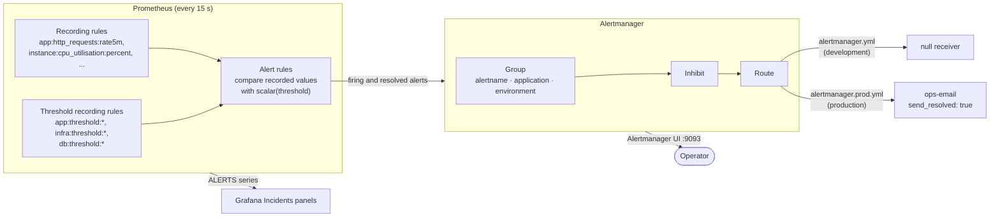
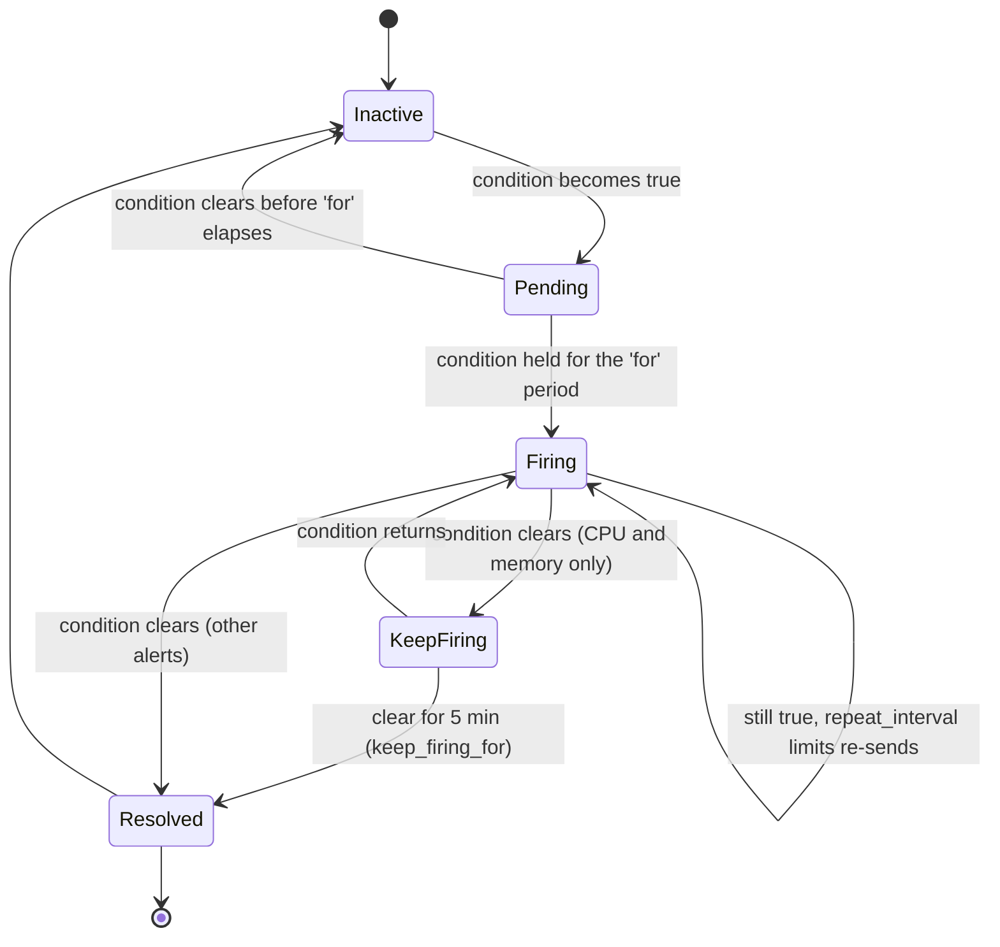
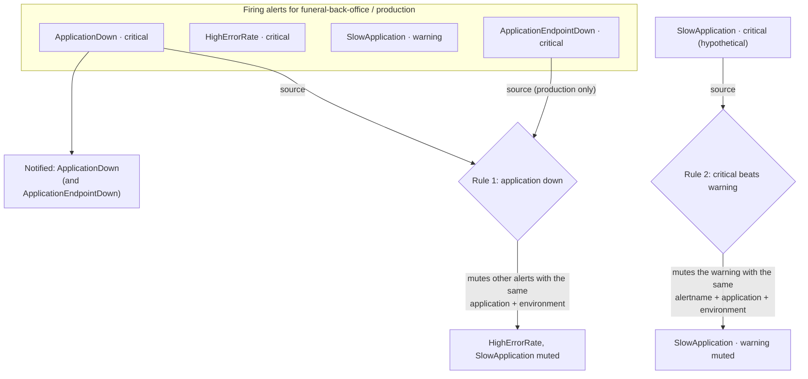
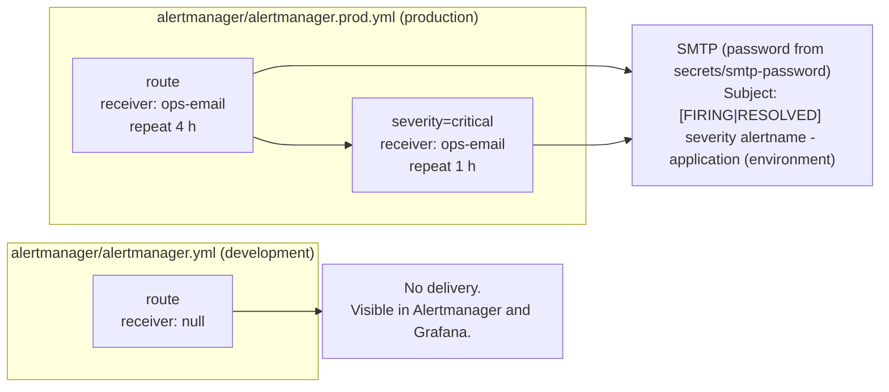
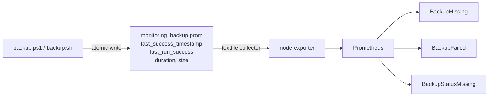

# Alerting

How alerts are defined, evaluated, grouped, suppressed and delivered. The source of truth is `prometheus/rules/*.yml` and `alertmanager/alertmanager*.yml`. This page explains them.

> **Notifications:** development has **no** notification receivers (`receiver: "null"`). Alerts appear only in Alertmanager (http://localhost:9093) and in Grafana's *Incidents* section. Production sends e-mail. Never send real notifications from tests without approval (CLAUDE.md §13).

## 1. Pipeline

**Thresholds are recording rules.** Each threshold is a one-line `vector(N)` rule (ADR-012), so tuning means editing one number in one place, and the alert expressions never change.

## 2. Alert lifecycle

- `for` stops one bad sample from raising an alert. `ApplicationDown` uses `for: 30s`, which is two consecutive failed scrapes at 15 s.
- `keep_firing_for: 5m` on `HighCpuUsage` and `HighMemoryUsage` stops a value hovering at the threshold from firing and resolving repeatedly. A 15-second fire and resolve cycle near 85% was observed in Phase 4.
- A resolved alert produces a recovery message in production (`send_resolved: true`).

## 3. Grouping, inhibition and repeat suppression

| Setting | Value | Effect |
|---|---|---|
| `group_by` | `alertname`, `application`, `environment` | One notification per alert, per application and environment (deduplication) |
| `group_wait` | 30 s | Waits before the first notification, so related alerts arrive together |
| `group_interval` | 5 min | Minimum gap before a changed group is notified again |
| `repeat_interval` | 4 h (production critical: 1 h) | Re-sends an unchanged, still-firing alert no more often than this |
| Inhibit rule 1 | Source `ApplicationDown` (production also `ApplicationEndpointDown`) | Mutes every other warning or critical alert with the same `application` and `environment` |
| Inhibit rule 2 | Source any `critical` | Mutes the `warning` of the same alert, application and environment |

## 4. Routing

Recipients, the SMTP host and the from address in `alertmanager.prod.yml` are placeholders until production details are known.

## 5. Alert catalogue

### Application (`prometheus/rules/application-alerts.yml`)

| Alert | Fires when | For | Severity | Threshold rule |
|---|---|---|---|---|
| `ApplicationDown` | `up{kind="application"} == 0`: the app's `/metrics` can't be scraped | 30 s | critical | none |
| `ApplicationReadinessFailure` | `app_dependency_up == 0` for any dependency | 2 min | critical | none |
| `DatabaseUnavailable` | `app_dependency_up{dependency="database"} == 0` (`SELECT 1` fails) | 1 min | critical | none |
| `HighErrorRate` | 5xx share of requests > 2% **and** traffic > 0.1 req/s | 5 min | critical | `app:threshold:error_ratio_5xx`, `app:threshold:min_request_rate` |
| `SlowApplication` | P95 request duration > 2 s | 5 min | warning | `app:threshold:p95_latency_seconds` |

The minimum request rate stops a single failed request on an idle app from reading as a 100% error rate.

### Database (`prometheus/rules/database-alerts.yml`)

| Alert | Fires when | For | Severity | Threshold rule |
|---|---|---|---|---|
| `PostgresDown` | `pg_up == 0`: postgres-exporter can't connect | 1 min | critical | none |
| `PostgresConnectionSaturation` | Connections in use > 80% of `max_connections` | 5 min | warning | `db:threshold:connection_saturation_percent` |

These cover GlitchTip's PostgreSQL. The Funeral Back Office uses SQLite, so its database is covered by `DatabaseUnavailable` instead.

### Infrastructure, endpoints, certificates (`prometheus/rules/infrastructure-alerts.yml`)

| Alert | Fires when | For | Severity | Threshold rule |
|---|---|---|---|---|
| `HighCpuUsage` | Host CPU > 85% (Windows or Linux) | 5 min, keep firing 5 min | warning | `infra:threshold:cpu_percent` |
| `HighMemoryUsage` | Host memory > 85%. Windows uses *available* memory (ADR-024). | 5 min, keep firing 5 min | warning | `infra:threshold:memory_percent` |
| `DiskSpaceCritical` | Any real disk > 90% used | 10 min | critical | `infra:threshold:disk_percent` |
| `InfrastructureExporterDown` | A `node`, `windows`, `postgres` or `blackbox-exporter` target is down | 2 min | warning | none |
| `ApplicationEndpointDown` | A Blackbox probe of an **application** health endpoint fails | 1 min | critical | none |
| `MonitoringComponentDown` | A Blackbox probe of a **monitoring-platform** component fails | 2 min | warning | none |
| `SslCertificateExpiringSoon` | Certificate expires in < 14 days | 10 min | warning | `infra:threshold:ssl_expiry_days` |

### Backups (`prometheus/rules/infrastructure-alerts.yml`, group `backup-alerts`)

| Alert | Fires when | For | Severity | Threshold rule |
|---|---|---|---|---|
| `BackupMissing` | Last successful backup > 24 h ago | 15 min | critical | `infra:threshold:backup_max_age_hours` |
| `BackupStatusMissing` | No backup status has ever been recorded | 1 h | critical | none |
| `BackupFailed` | The last backup run reported failure | immediate | critical | none |

The backup metrics come from `exporters/textfile/monitoring_backup.prom`, which `scripts/backup.ps1` writes and node-exporter reads:

## 6. Changing a threshold

1. Edit the `vector(N)` value of the threshold rule in the relevant rule file.
2. Run `.\scripts\validate.ps1`. It runs `promtool check rules` and the alert unit tests in `prometheus/tests/`.
3. Reload Prometheus: `Invoke-RestMethod -Method Post http://127.0.0.1:9090/-/reload`.
4. Update the description annotation if it quotes the old number, and update this page.

## 7. How alerts are tested

| Alert group | How | Where |
|---|---|---|
| Application down and recovery | Stop and restart Django | TASKS.md, Phase 2 |
| Readiness and database | Out-of-tree settings that point the database at a missing file | `tests/test_readiness_db_failure.py` |
| Error rate and latency | Test-mode routes that return 500 or sleep, plus a traffic generator | `tests/generate_test_traffic.py` |
| Exporter, PostgreSQL and Loki outages | Stop the containers, wait for the alerts, restart, wait for them to resolve | `tests/failure_simulation.ps1` |
| CPU, memory, disk, TLS, backups, endpoint, PostgreSQL | Synthetic series in promtool unit tests (unsafe to trigger for real) | `prometheus/tests/*.test.yml` |
