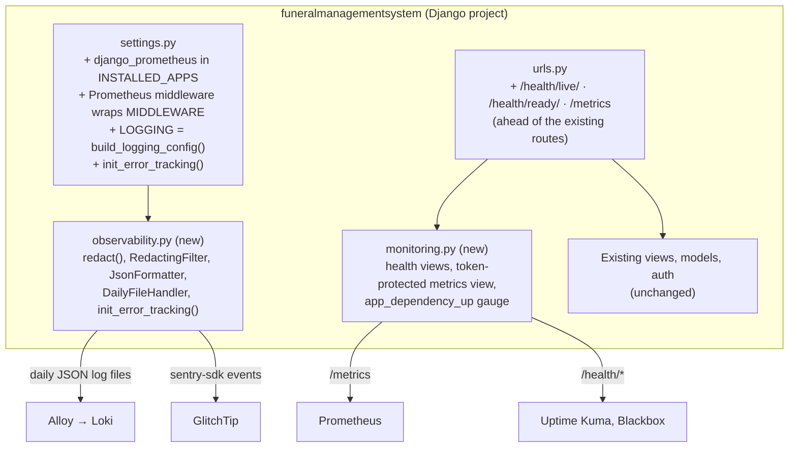
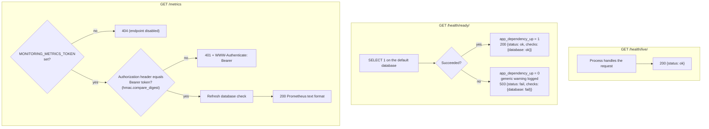
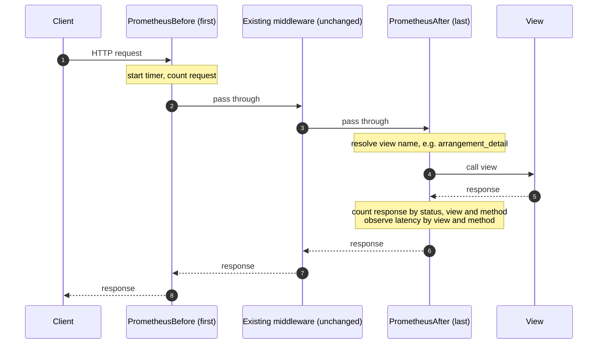
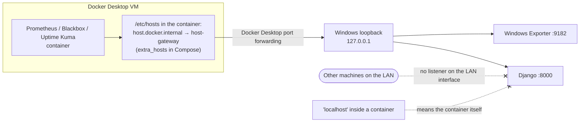
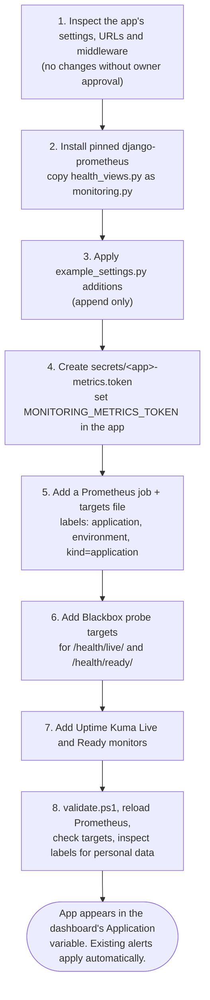

# Application integration

## Funeral Back Office System (integrated in Phase 2)

| Item | Value |
|---|---|
| Source (active copy) | `Desktop\funeral app\funeralmanagementsystem` (top-level, untracked by Git) |
| Python environment | pipenv: `%USERPROFILE%\.virtualenvs\funeral_app-RXgBHIcv` (Pipfile in `Desktop\funeral app`) |
| Django / DB | Django 6.1.3 (upgrade from 6.1.2 accepted 2026-11-25) / SQLite |
| Instrumentation | `django-prometheus==2.6.0.dev26` (see ADR-009) |
| Prometheus job | `funeral-back-office`, labels `application=funeral-back-office`, `environment=development` |

### What the integration adds to the application

The integration only adds to the app. Existing views, settings, middleware and authentication are unchanged.



### Changes made to the application (additions only)

| File | Change |
|---|---|
| `funeralmanagementsystem/monitoring.py` | **New.** Health views and the token-protected metrics view |
| `funeralmanagementsystem/settings.py` | Appended `django_prometheus` to `INSTALLED_APPS`. Wrapped `MIDDLEWARE` with the Before/After middleware. Extended `ALLOWED_HOSTS`. |
| `funeralmanagementsystem/urls.py` | Added three routes ahead of the existing ones |
| `requirements.txt`, `Desktop\funeral app\Pipfile` and `Pipfile.lock` | Added the pinned `django-prometheus` |

Pre-change copies of these files are in `monitoring-app/backups/funeral-app-pre-phase2-*` (git-ignored).

### Phase 3 changes to the application (additions only)

| File | Change |
|---|---|
| `funeralmanagementsystem/observability.py` | **New.** Contains `redact()`, `RedactingFilter`, `JsonFormatter`, `DailyFileHandler` and `init_error_tracking()` |
| `funeralmanagementsystem/settings.py` | Appended a `LOGGING` block built by `build_logging_config()`, plus `init_error_tracking()` |
| `requirements.txt` and `Pipfile` | Added `sentry-sdk==3.0.1`. Pinned `django==6.1.3` in the Pipfile (ADR-020). |
| `.gitignore` | Added `logs/` |

Pre-change copies are in `monitoring-app/backups/funeral-app-pre-phase3-*`.

| Environment variable | Purpose | Default |
|---|---|---|
| `MONITORING_METRICS_TOKEN` | Enables `/metrics` | unset, so `/metrics` returns 404 |
| `GLITCHTIP_DSN` | Enables error tracking | unset, so error tracking is off |
| `MONITORING_ENVIRONMENT` | `environment` label on logs and errors | `development` |
| `APP_LOG_DIR` | JSON log directory | `<BASE_DIR>\logs` |
| `APP_LOG_RETENTION_DAYS` | How long daily log files are kept | `7` |

### Running the app with monitoring

```powershell
.\scripts\run-funeral-app.ps1             # normal
.\scripts\run-funeral-app.ps1 -TestMode   # adds the failure-simulation routes (development only)
```

The script reads the token and DSN from `secrets/` and starts `runserver 127.0.0.1:8000 --noreload` with the app's pipenv Python. `--noreload` keeps a single process writing the log file.

Always bind to **`127.0.0.1:8000`**. Phase 2 confirmed that containers can still reach a loopback-bound app through `host.docker.internal`, so no `0.0.0.0` binding or Windows Firewall rule is needed. If the token variable is not set, `/metrics` returns 404 and Prometheus shows the target as down.

## Integration contract

| Endpoint | Purpose | Healthy | Unhealthy |
|---|---|---|---|
| `/health/live/` | The process responds | `200 {"status":"ok"}` | No response |
| `/health/ready/` | The database answers `SELECT 1` | `200 {"status":"ok","checks":{"database":"ok"}}` | `503 {"status":"fail","checks":{"database":"fail"}}` |
| `/metrics` | Prometheus metrics | 200 with a valid `Authorization: Bearer <token>` | 401 for a missing or wrong token. 404 if no token is configured. |

The health responses are marked `never_cache` and contain no hostnames, paths, exception text or personal data. Readiness failures log only a generic warning.

#### Endpoint decision logic



Only `GET` is accepted. Any other method gets 405.

#### How a request is measured

`PrometheusBeforeMiddleware` is placed first in `MIDDLEWARE` and `PrometheusAfterMiddleware` last, so the measurement wraps the whole request, including the existing middleware.



Labels use the resolved **view name**, never the URL. `/arrangements/1/` and `/arrangements/999999/` both become `view="arrangement_detail"`, and unmatched URLs become `<unnamed view>`.

### Metrics exposed

- `django_http_requests_total_by_view_transport_method_total`: requests, by view and method
- `django_http_responses_total_by_status_view_method_total`: responses, by status code and view
- `django_http_requests_latency_seconds_by_view_method_bucket`: a latency histogram, used for P95 and P99
- `app_dependency_up{dependency="database"}`: readiness as a gauge, refreshed on each scrape

### Privacy verification (Phase 2)

All 345 exported series were inspected. The only label values present are view names (for example `arrangement_detail`), HTTP methods, status codes, Python version, template names and `dependency=database`. Requests to `/arrangements/1/` and `/arrangements/999999/` both map to `view="arrangement_detail"`, and unmatched URLs map to `<unnamed view>`. No IDs, paths or personal data appear.

## Networking (Docker to Windows)

- Inside a container, `localhost` is the container itself. Prometheus and Uptime Kuma use `host.docker.internal`, which is mapped with `extra_hosts: host-gateway`.
- `ALLOWED_HOSTS` includes `host.docker.internal`.
- Docker Desktop forwards that traffic to the Windows loopback interface. This was verified with Django listening only on `127.0.0.1:8000`.



## Uptime Kuma monitors (manual, after the setup wizard)

| Monitor | Type | URL | Interval | Retries | Accepted codes |
|---|---|---|---|---|---|
| Funeral Back Office - Live | HTTP(s) | `http://host.docker.internal:8000/health/live/` | 30 s | 1 (so 2 consecutive failures mark it down) | 200-299 |
| Funeral Back Office - Ready | HTTP(s) - Keyword | `http://host.docker.internal:8000/health/ready/`, keyword `"status": "ok"` | 60 s | 2 | 200-299 |

Do not configure notifications until they have been approved.

## Test harness (development only)

`tests/django_harness/` layers test-only settings and URLs on top of the app **without modifying it**:

- `MONITORING_TEST_DB_FAIL=1` points the database at a non-existent path. The real `db.sqlite3` is never touched.
- `/_monitoring-test/error/` returns HTTP 500, and `/_monitoring-test/slow/?s=N` sleeps for N seconds (at most 10).

These routes exist only when `DJANGO_SETTINGS_MODULE=monitoring_test_settings`. Never use that mode outside local development.

## Adding another application



See [integrations/django/README.md](../integrations/django/README.md). Every target must carry `application` and `environment` labels, and the dashboard and alerts pick it up automatically. The application's own `/metrics` target must also carry `kind: application`, which `ApplicationDown` matches on. Infrastructure exporters for the same application, such as `windows`, must not carry `kind`.
