# Architecture

> **Status:** describes the platform as built through Phase 5 (2026-11-26). The development stack runs on the Windows laptop. The production layout is designed and tested locally but **not deployed yet** (see [deployment.md](deployment.md)).
>
> **Schematics** are [Mermaid](https://mermaid.js.org/) diagrams. GitHub renders them directly. In VS Code, install the *Markdown Preview Mermaid Support* extension to see them in the Markdown preview. A list of every schematic in the docs is in [schematics.md](schematics.md).

## 1. System context

Who and what the platform talks to. Dashed lines are production-only or future.

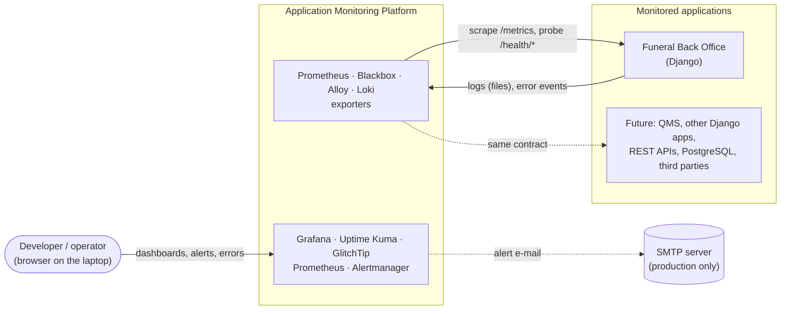

The platform is **independent** of the applications it watches. Nothing from the platform is installed into an application except the instrumentation in [integrations/django/](../integrations/django/). If an application fails, only its targets turn `down`.

## 2. Components

| Service | Version | Role | Local address | Persistent volume | Limits (CPU / RAM) | Health check |
|---|---|---|---|---|---|---|
| Prometheus | v3.16.0 | Pulls and stores metrics, evaluates alert rules | 127.0.0.1:9090 | `monitoring-prometheus-data` | 1.0 / 512M | `/-/healthy` |
| Alertmanager | v0.35.1 | Groups, deduplicates, inhibits and routes alerts | 127.0.0.1:9093 | `monitoring-alertmanager-data` | 0.5 / 128M | `/-/healthy` |
| Grafana OSS | 13.3.2 | Dashboards. Data sources and dashboards come from files. | 127.0.0.1:3000 | `monitoring-grafana-data` | 1.0 / 768M | `/api/health` |
| Uptime Kuma | 2.5.12 | User-facing up/down checks and history | 127.0.0.1:3001 | `monitoring-uptime-kuma-data` | 1.0 / 512M | image built-in |
| Loki | 3.7.10 | Log storage, 7-day retention | 127.0.0.1:3100 (API) | `monitoring-loki-data` | 1.0 / 384M | none (distroless). Probed by Blackbox. |
| Alloy | v1.22.0 | Tails the app's log files, redacts, pushes to Loki | internal `alloy:12345` | `monitoring-alloy-data` | 0.5 / 256M | scraped by Prometheus |
| GlitchTip | 6.2.6 | Exception tracking (Sentry protocol), web and worker in one container | 127.0.0.1:8001 | `monitoring-glitchtip-uploads` | 1.0 / 512M | `/_health/` |
| PostgreSQL | 18.7 | GlitchTip's database, queue and cache | internal only | `monitoring-glitchtip-postgres-data` | 1.0 / 256M | `pg_isready` |
| Node Exporter | v1.13.1 | Docker Desktop VM metrics, plus backup textfile metrics | internal `node-exporter:9100` | none | 0.25 / 64M | scraped |
| Blackbox Exporter | v0.29.1 | Prometheus-side HTTP and TLS probes | internal `blackbox-exporter:9115` | none | 0.25 / 64M | `/-/healthy` |
| PostgreSQL Exporter | v0.21.1 | GlitchTip database metrics (read-only `pg_monitor` role) | internal `postgres-exporter:9187` | none | 0.25 / 64M | scraped |
| Windows Exporter | v0.32.1 | Laptop CPU, memory and disk. **Windows service, not a container.** | 127.0.0.1:9182 | none | n/a | scraped |

Total container memory limits add up to about 3.5 GB. Measured idle use of the whole stack is about 0.9 GB.

## 3. Local deployment topology (development)

Everything runs on one Windows laptop. Containers share the `monitoring-network` bridge and reach each other by service name. Published ports are bound to `127.0.0.1` only. Containers reach native Windows processes through `host.docker.internal`, which Compose maps to the host gateway.

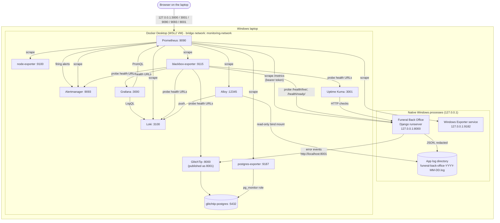

Arrows into `django` and `winexp` cross the VM boundary through `host.docker.internal`. Django still listens only on `127.0.0.1:8000`: Docker Desktop forwards container traffic to Windows loopback, so no `0.0.0.0` binding or firewall rule is needed (verified in Phase 2).

### Port map

| Port | Bound to | Service | Who uses it |
|---:|---|---|---|
| 3000 | 127.0.0.1 | Grafana | Operator browser |
| 3001 | 127.0.0.1 | Uptime Kuma | Operator browser |
| 9090 | 127.0.0.1 | Prometheus | Operator browser, scripts |
| 9093 | 127.0.0.1 | Alertmanager | Operator browser |
| 3100 | 127.0.0.1 | Loki (API) | Scripts, tests. Users browse logs through Grafana. |
| 8001 | 127.0.0.1 | GlitchTip | Operator browser, Django error reporting |
| 8000 | 127.0.0.1 | Django (not a container) | Users. Prometheus, Blackbox and Uptime Kuma through `host.docker.internal`. |
| 9182 | 127.0.0.1 | Windows Exporter (not a container) | Prometheus through `host.docker.internal` |
| 5432, 9100, 9115, 9187, 12345 | not published | PostgreSQL, exporters, Alloy | Other containers on `monitoring-network` only |

`scripts/validate.ps1` fails if any published port is bound to anything other than `127.0.0.1`.

## 4. Startup order

Compose starts services in dependency order. Services without arrows start immediately, and every service uses `restart: unless-stopped`.

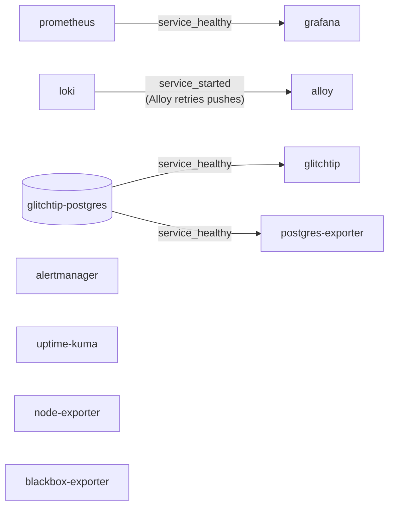

Prometheus does not wait for Alertmanager: it queues alerts and retries the delivery.

## 5. Data flows

The platform has four independent signal pipelines and one alerting pipeline.

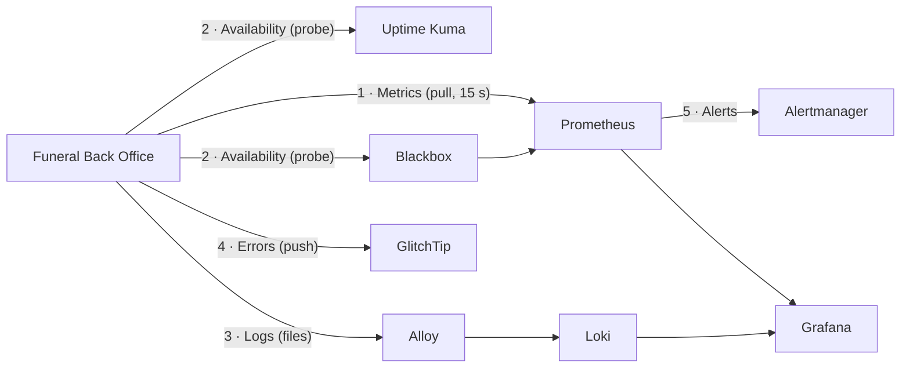

### 5.1 Metrics (pull)

Prometheus scrapes every target every 15 seconds. Blackbox probes run every 30 seconds and TLS probes every hour. Targets and their labels come from `prometheus/targets/<environment>/<job>.yml` (file service discovery), and changes are picked up without a restart.

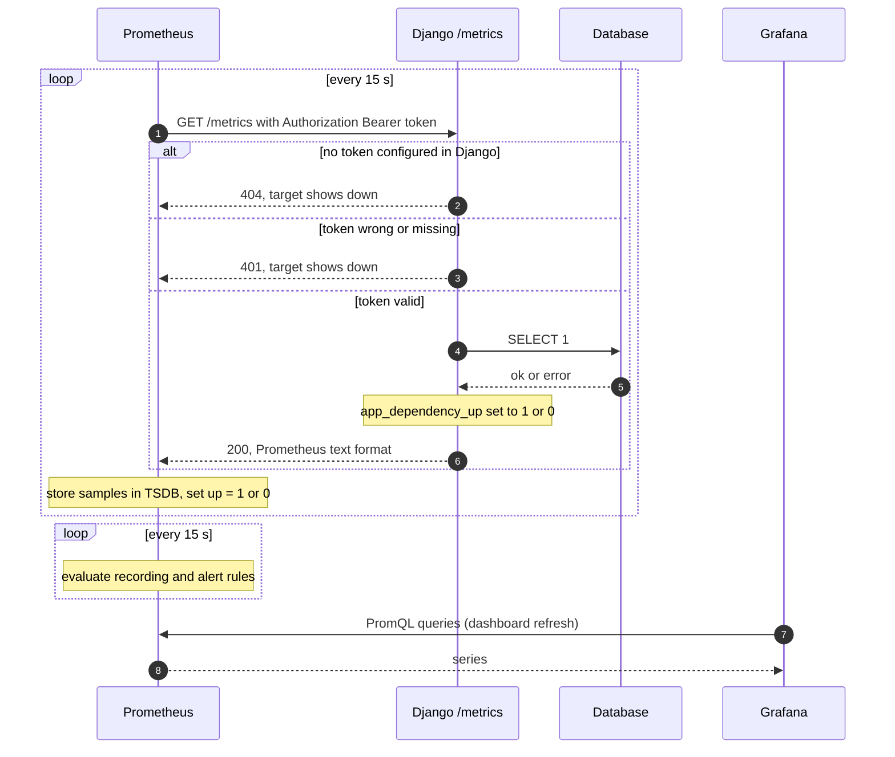

### 5.2 Three availability signals

Availability is measured three different ways. The dashboards label them separately.

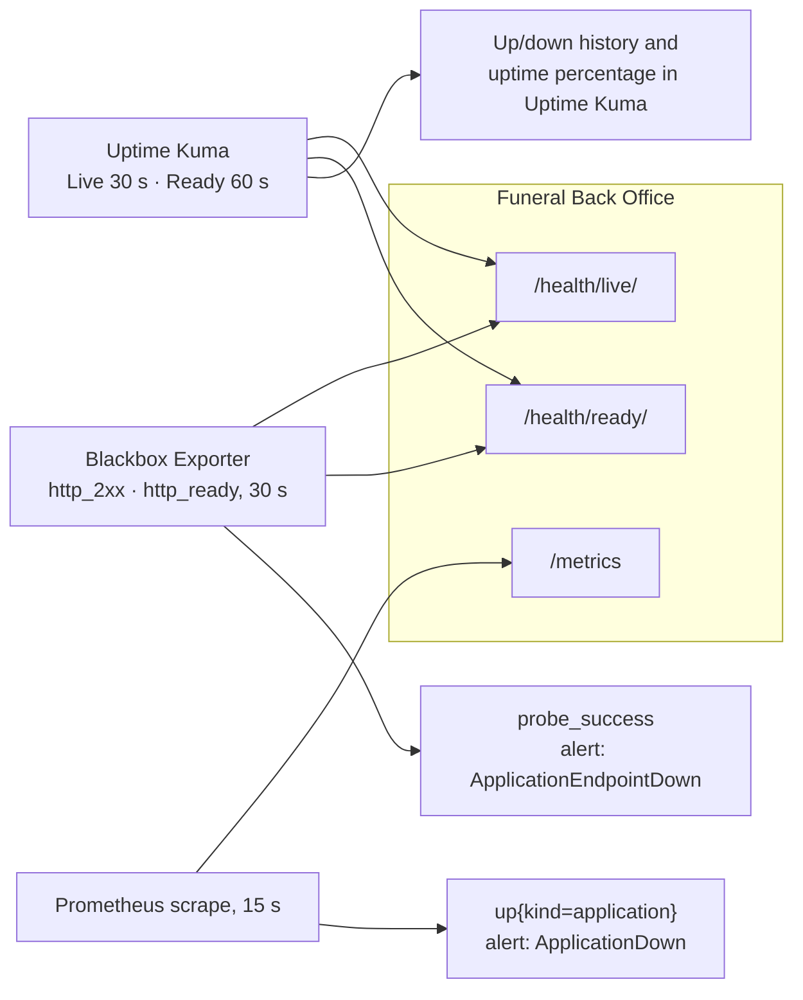

| Signal | Question it answers | Where it shows | Alerts |
|---|---|---|---|
| Uptime Kuma | Does the app answer its health endpoints from outside? This is the **user-facing** up/down signal. | Uptime Kuma UI | Uptime Kuma notifications (none configured yet) |
| Blackbox `probe_success` | The same question, but recorded in Prometheus so it can alert and be graphed | Grafana *Infrastructure* and *Incidents* | `ApplicationEndpointDown`, `MonitoringComponentDown` |
| Prometheus `up` | Could Prometheus collect metrics? This is **not** proof that users can reach the app. | Grafana *Scrape availability* | `ApplicationDown` |

### 5.3 Logs

Logs are redacted twice: in the application before the line is written, and again in Alloy before it reaches Loki.

```mermaid
flowchart LR
    subgraph django["Django process (Windows)"]
        rec["logging call"] --> rf["RedactingFilter<br/>IDs, phones, e-mails,<br/>tokens, query strings"]
        rf --> jf["JsonFormatter<br/>ts, level, logger, message,<br/>application, environment"]
        jf --> dfh["DailyFileHandler<br/>one append-only file per day,<br/>7-day pruning"]
    end

    dfh --> file[("funeral-back-office-<br/>YYYY-MM-DD.log")]

    subgraph alloy["Alloy container"]
        fm["local.file_match<br/>every 10 s"] --> src["loki.source.file<br/>poll 1-5 s"]
        src --> proc["loki.process<br/>json → timestamp → label: level<br/>→ metadata: logger, exception_type<br/>→ 4 × stage.replace (redact)"]
        proc --> wr["loki.write<br/>60 retries, backoff ≤ 30 s<br/>(≈ 30 min outage tolerance)"]
    end

    file -->|"read-only bind mount"| fm
    wr -->|"HTTP push"| loki[("Loki<br/>retention 168 h")]
    loki -->|"LogQL"| graf["Grafana<br/>Logs section, Explore"]
```

Only `application`, `environment`, `source`, `collector` and `level` are indexed labels. `logger` and `exception_type` are structured metadata, which keeps stream cardinality low.

### 5.4 Errors

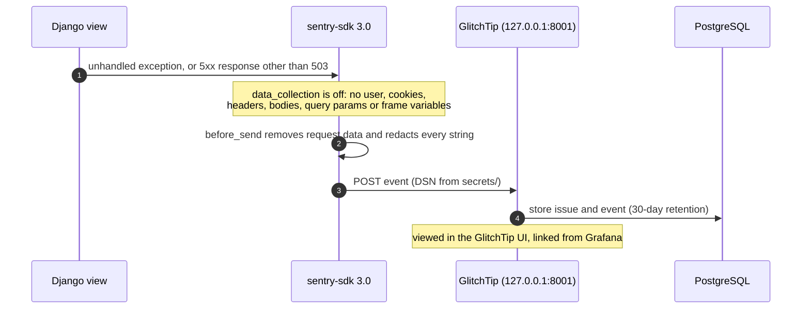

503 is excluded because `/health/ready/` returns it deliberately during a dependency outage, and that must not flood GlitchTip.

### 5.5 Alerting

Prometheus evaluates the rules in `prometheus/rules/*.yml` every 15 seconds and sends firing alerts to Alertmanager. The full alert catalogue, routing and inhibition are in [alerting.md](alerting.md).

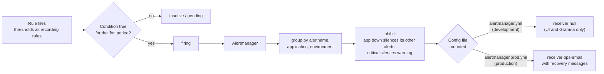

## 6. Labelling model

Every target carries `application` and `environment`. The dashboards' variables, the alert annotations and Alertmanager's grouping all use these two labels, so a new application appears everywhere once its targets are labelled.

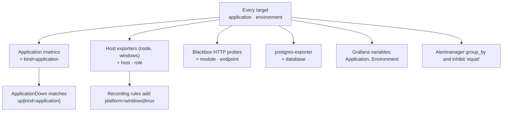

**Privacy rule:** labels hold only view names, HTTP methods, status codes and the values above. Raw URLs, IDs and personal data never become labels (verified across 345 series in Phase 2).

## 7. Persistent storage and backups

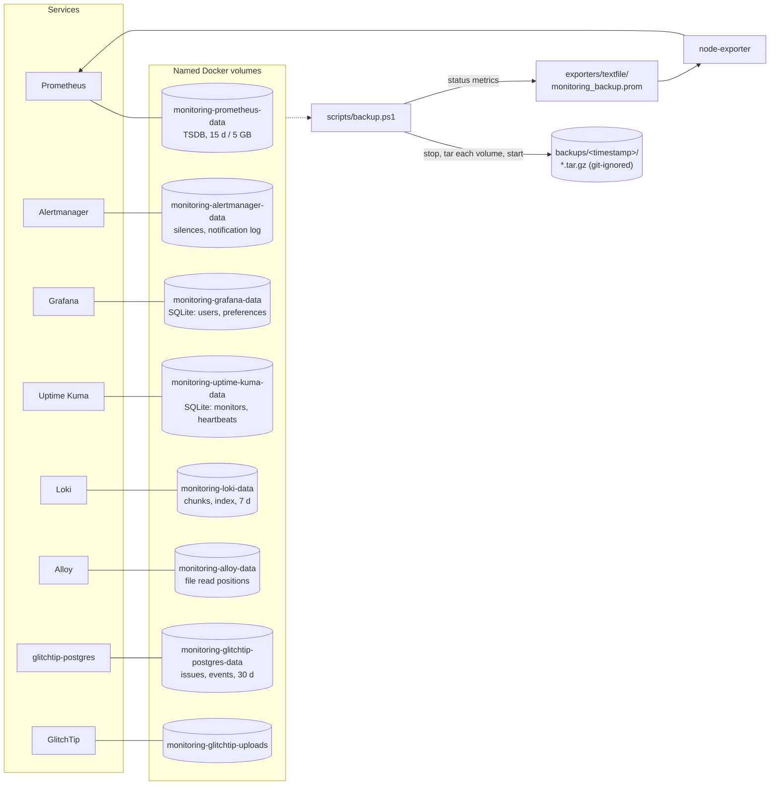

Dashboards, data sources, alert rules and targets are **not** in volumes. They live in Git and are mounted read-only, so they are recreated on every start.

## 8. Configuration map

Which file in the repository feeds which service, and how.

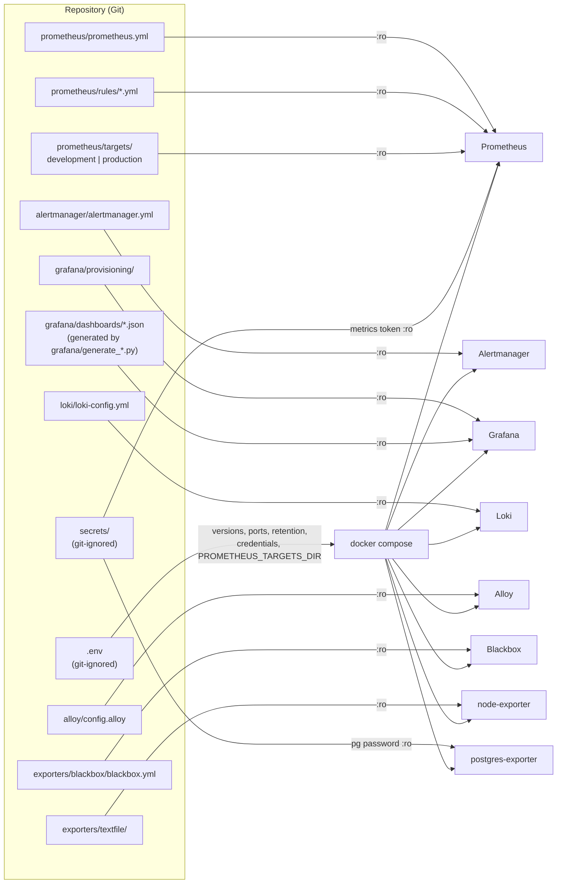

| Path | Contents |
|---|---|
| `prometheus/prometheus.yml` | Job definitions only (ADR-029) |
| `prometheus/targets/<env>/<job>.yml` | Targets and their labels, one file per job |
| `prometheus/rules/*.yml` | Thresholds, recording rules and alerts for applications, databases and infrastructure |
| `prometheus/tests/*.test.yml` | promtool unit tests for alerts that can't safely be triggered for real |
| `grafana/provisioning/` | Prometheus and Loki data sources, dashboard provider |
| `grafana/dashboards/*.json` | *Application Overview* and *Monitoring Platform Health*, generated by the Python scripts beside them |
| `docker-compose.prod.yml`, `caddy/`, `deploy/` | Production overlay and app-server agents (see [deployment.md](deployment.md)) |

## 9. Failure domains

What happens when each part fails, and what detects it. The first five rows were exercised in the Phase 2 to Phase 5 tests (results in [TASKS.md](../TASKS.md)). The last two are known gaps.

| Failure | Effect | Detected by |
|---|---|---|
| Django stops | No new metrics, logs or errors from the app. The platform keeps running. | `ApplicationDown`, `ApplicationEndpointDown`, Uptime Kuma |
| App database unavailable | `/health/ready/` returns 503. `app_dependency_up` = 0. | `DatabaseUnavailable`, `ApplicationReadinessFailure`, Uptime Kuma Ready monitor |
| Loki down | Alloy queues and retries for about 30 minutes, so no logs are lost | `MonitoringComponentDown` (Blackbox probe on `loki:3100/ready`) |
| GlitchTip database down | Error events can't be stored | `PostgresDown` (GlitchTip's own `/_health/` stays 200, see security review O6) |
| An exporter down | Gap in host or database metrics | `InfrastructureExporterDown` |
| Prometheus or Alertmanager down | **Nothing alerts.** Uptime Kuma keeps checking independently. | Not yet covered: needs an external heartbeat (security review O1) |
| Laptop or Docker Desktop down | Everything stops, monitoring included | Not covered in development. Production separates the servers. |

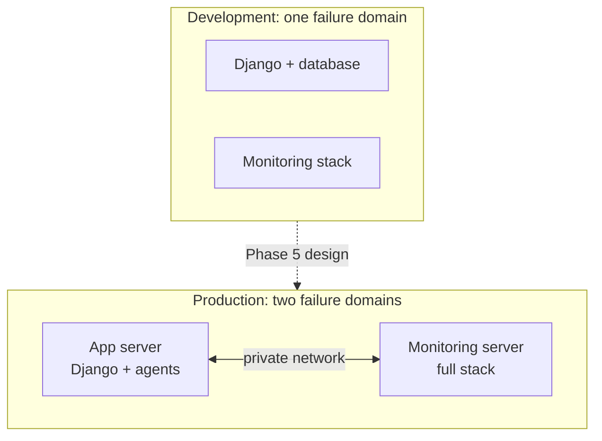

## 10. Development and production compared

| Aspect | Development (this laptop) | Production (designed, not deployed) |
|---|---|---|
| Hosts | One Windows laptop | Separate Linux monitoring server and app server |
| Compose files | `docker-compose.yml` | `docker-compose.yml` + `docker-compose.prod.yml`, plus `deploy/app-server/` on the app server |
| Targets | `prometheus/targets/development/` | `prometheus/targets/production/` |
| External access | None. Everything on 127.0.0.1. | Caddy on 443 for Grafana and GlitchTip only. SSH tunnel for the rest. |
| Log collector | Alloy container on the laptop | Alloy on the app server, pushing to Loki's private IP |
| Notifications | Alertmanager `null` receiver | E-mail through SMTP |
| Retention | Metrics 15 d / 5 GB, logs 7 d | Metrics 30 d / 20 GB, logs 14 d |

The production topology is drawn in [deployment.md](deployment.md#1-target-architecture).
