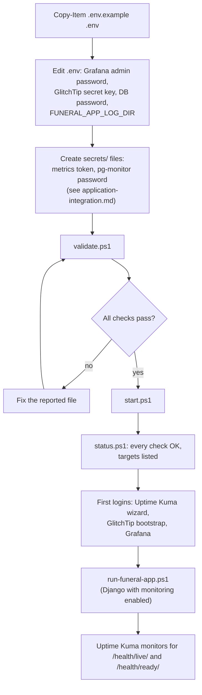
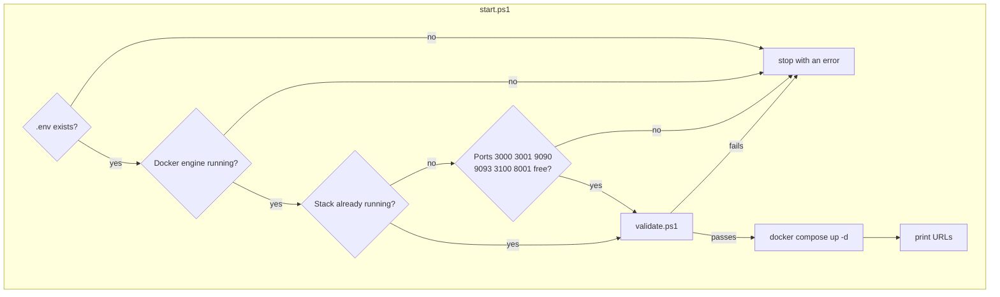

# Local setup (Windows)

## Prerequisites

- Docker Desktop with the WSL2 backend, running
- PowerShell 5.1 or later
- These ports free on 127.0.0.1: **3000, 3001, 9090, 9093, 3100, 8001** (checked by `start.ps1`), plus 8000 for Django and 9182 for Windows Exporter
- About 1 GB of RAM for the stack at idle. Container limits add up to about 3.5 GB (see [architecture.md](architecture.md#2-components)).
- Optional: Windows Exporter for laptop metrics, installed with `scripts\install-windows-exporter.ps1` (needs one UAC prompt)

## First run



```powershell
cd application-monitoring
Copy-Item .env.example .env
# Edit .env and set GRAFANA_ADMIN_PASSWORD to a long random value. To generate one:
-join ((48..57)+(65..90)+(97..122) | Get-Random -Count 32 | % {[char]$_})

.\scripts\validate.ps1
.\scripts\start.ps1
.\scripts\status.ps1
```

## First login

| Service | Steps |
|---|---|
| Grafana, http://localhost:3000 | Log in with `GRAFANA_ADMIN_USER` and `GRAFANA_ADMIN_PASSWORD` from `.env`. The Prometheus and Loki data sources and both dashboards (*Application Overview*, *Monitoring Platform Health*) are already provisioned in the *Application Monitoring* folder. |
| Uptime Kuma, http://localhost:3001 | The first visit opens the setup wizard. Choose **Embedded SQLite** as the database (lowest resource use), then create an admin account with a strong password. Uptime Kuma has no environment variable for preseeding this account. |
| GlitchTip, http://localhost:8001 | Log in with `GLITCHTIP_ADMIN_EMAIL` and `GLITCHTIP_ADMIN_PASSWORD` from `.env`, then change the password. On a fresh install, run `scripts/glitchtip-bootstrap.py` first; the docstring explains how, and the DSN is written to `secrets/`. |
| Prometheus, http://localhost:9090 | No login. It is reachable from localhost only. Check **Status → Targets**. |
| Alertmanager, http://localhost:9093 | No login, localhost only. Shows firing alerts and silences. |

## What the scripts do



| Script | What it does | Touches data? |
|---|---|---|
| `validate.ps1` | `compose config`, promtool checks and alert unit tests, amtool, Loki and Alloy config checks, production overlay, Caddyfile and app-server bundle, dashboard JSON, `.env` placeholders, `.env` git-ignored, localhost-only port bindings | No |
| `start.ps1` | The flow above | No |
| `status.ps1` | Container states, the health endpoint of each service, and every Prometheus target. The exit code is the number of failed checks. | No |
| `stop.ps1` | `docker compose stop`. Never `down -v`. | No, volumes kept |
| `backup.ps1` | Stops the stack, archives every volume to `backups\<timestamp>\`, starts the stack, writes backup metrics | Reads volumes |
| `restore.ps1` | Drill by default, into temporary volumes. `-Mode Live -Force` replaces live data. | Drill: no. Live: **yes** |
| `run-funeral-app.ps1` | Starts Django on 127.0.0.1:8000 with the metrics token, DSN and environment set | No |
| `install-windows-exporter.ps1` | Verifies the MSI checksum, installs the service bound to 127.0.0.1:9182 | Installs software (UAC) |

## Day-to-day commands

| Task | Command |
|---|---|
| Start | `.\scripts\start.ps1` |
| Stop (keeps data) | `.\scripts\stop.ps1` |
| Status | `.\scripts\status.ps1` |
| Validate config | `.\scripts\validate.ps1` |
| Back up volumes | `.\scripts\backup.ps1` |
| Reload Prometheus config | `Invoke-RestMethod -Method Post http://127.0.0.1:9090/-/reload` |
| View logs | `docker compose logs -f prometheus` |

> Never use `docker compose down -v`. The `-v` flag deletes all monitoring data. `docker compose down` without `-v` is safe, because it removes containers but keeps the volumes.

## Upgrading an image

1. Check the release notes for breaking changes.
2. Change the version in `.env`, and in `.env.example` and the Compose defaults.
3. Run `.\scripts\backup.ps1`, then `docker compose pull`, then `docker compose up -d`.
4. Run `.\scripts\status.ps1`, then update `CHANGELOG.md`.
