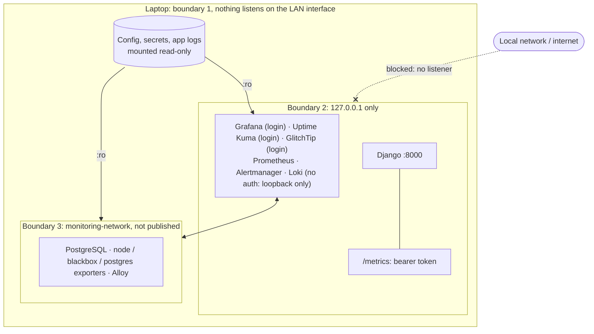
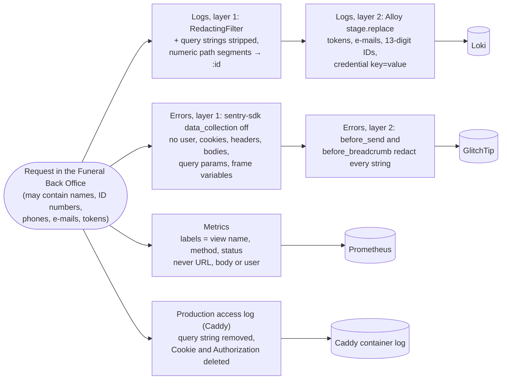
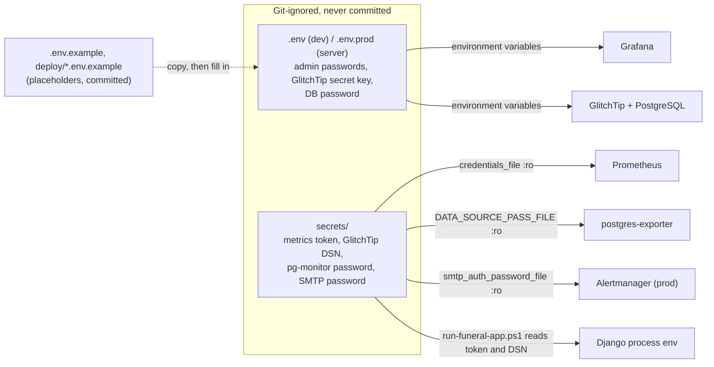

# Security and privacy

The monitored Funeral Back Office System processes sensitive personal information, so POPIA applies. The monitoring platform must never collect or expose that information.

## Trust boundaries (development)

| Boundary | Control | Enforced by |
|---|---|---|
| Laptop to network | Every published port is on 127.0.0.1 | Compose port syntax, checked by `validate.ps1` |
| Loopback to services | Logins on Grafana, Uptime Kuma and GlitchTip. Bearer token on `/metrics`. | Service config, `monitoring.py` |
| Container network | PostgreSQL, exporters and Alloy publish no ports | `docker-compose.yml` |
| Containers to host | No privileged mode, no Docker socket, `no-new-privileges`, read-only mounts | `docker-compose.yml`, security review checks |

The production boundaries (Caddy, the private network and the SSH tunnel) are drawn in [deployment.md](deployment.md#3-network-and-firewall).

## Personal data: defence in depth

Every path that carries text from the application is filtered at least once before storage, and log lines twice.

`tests/test_redaction.py`, `tests/test_privacy_end_to_end.py` (9 fake sensitive values) and `tests/test_https_prod_overlay.ps1` (4 values in the access log) confirm that none of these paths stores the injected data.

## Where secrets live

## Controls in place (Phase 1)

| Control | Implementation |
|---|---|
| No network exposure | Every published port is bound to `127.0.0.1`. `validate.ps1` enforces this. |
| Secrets kept out of Git | Credentials live in `.env`, which is git-ignored. `.env.example` holds placeholders only. |
| No default passwords | Compose refuses to start if `GRAFANA_ADMIN_USER` or `GRAFANA_ADMIN_PASSWORD` is unset. `validate.ps1` rejects placeholder values. |
| Grafana hardening | Sign-up is disabled, anonymous access is disabled, telemetry and update checks are off, Gravatar is off, and cookies use SameSite=strict. |
| Read-only configuration | Prometheus and Grafana configuration is mounted `:ro`. |
| Least privilege | No privileged containers and no Docker socket mount. Prometheus runs as `nobody` and Grafana as UID 472. |
| Resource isolation | Memory limits are 512 MB for Prometheus, 768 MB for Grafana and 512 MB for Uptime Kuma. Each container is limited to 1 CPU, and logs are rotated (3 × 10 MB). |
| Retention | Prometheus keeps 15 days of data, capped at 5 GB. Both values are configurable in `.env`. |

## Controls added in Phase 2

| Control | Implementation |
|---|---|
| Metrics endpoint access | `/metrics` requires a bearer token, compared with `hmac.compare_digest`. It returns 401 without a valid token and 404 when no token is configured. The token lives in `secrets/`, which is git-ignored, and is mounted read-only into Prometheus. |
| No raw URLs in labels | Labels use Django view names. Verified: `/arrangements/<id>/` maps to `view="arrangement_detail"`. |
| Health endpoints leak nothing | They return fixed JSON only. A test confirms that no paths, engine names or exception text appear in the 503 body. |
| App not exposed to the LAN | Django is bound to `127.0.0.1:8000`, verified with `Get-NetTCPConnection`. |
| No external notifications | Alertmanager's only receiver is `null`. |
| Real data untouched by tests | The database-failure test uses an out-of-tree settings override and never touches `db.sqlite3`. |

## Controls added in Phase 3

| Control | Implementation |
|---|---|
| Logs redacted at source | `RedactingFilter` masks SA ID numbers, phone numbers, emails, 13-19 digit numbers, credentials, bearer and basic tokens, and cookies. It strips query strings and replaces numeric path segments with `:id`. The `HttpRequest` object is never serialized. |
| Second redaction layer | Alloy `stage.replace` covers ID numbers, emails, tokens and credentials |
| Error events minimised | sentry-sdk 3.0 `data_collection` is entirely off: no user info, cookies, headers, bodies, query params, frame variables or DB query data. `before_send` and `before_breadcrumb` remove the remaining request data and redact all strings. `server_name` is the app name, not the hostname. |
| GlitchTip hardened | Sign-up and organization creation are disabled. The database has a password and is not published. `ALLOWED_HOSTS` is restricted, IP scrubbing is enabled on the project, and email goes to the console only. |
| Verified end to end | `tests/test_privacy_end_to_end.py` injects 9 fake sensitive values and checks that none reach GlitchTip or Loki |
| Retention | Loki keeps 7 days. GlitchTip keeps 30 days. App log files are kept 7 days (`APP_LOG_RETENTION_DAYS`). |
| Secrets | The GlitchTip secret key, DB password and admin password are in `.env`. The DSN is in `secrets/`. All are git-ignored. |

**Limitation:** redaction is pattern-based and best effort. Free-text fields such as names are only removed where they appear in query strings. Code must not log personal data.

## Controls added in Phase 4

| Control | Implementation |
|---|---|
| Exporters not exposed | Node, Blackbox and PostgreSQL exporters publish no ports. Windows Exporter binds to 127.0.0.1:9182 and adds no firewall exception. |
| Read-only host access | node-exporter mounts the VM's `/proc`, `/sys` and `/` as `:ro`. It is not privileged and has no host PID or network namespace. |
| Least-privilege database account | The `monitoring` role has `pg_monitor`, read-only transactions and a 3-connection limit. Verified that it cannot read table data or write. The password is in `secrets/`. |
| Verified installer | The windows_exporter MSI SHA-256 is checked against the GitHub release before install. |
| Backups | Archives of all volumes, including GlitchTip events and logs (already redacted) and password hashes. They're kept in git-ignored `backups/`. They are not encrypted, so store them securely. |

## Funeral Back Office findings (outside monitoring scope; not changed)

- The active `settings.py` hardcodes `SECRET_KEY` and has `DEBUG=True`. The Git-tracked snapshot reads the key from `DJANGO_SECRET_KEY`. Treat the hardcoded key as compromised before any hosted use.
- The active source tree is not tracked by Git. Only an older nested snapshot is committed.

## Known limitations (local development)

- Traffic uses plain HTTP. This is acceptable on loopback only. Production needs HTTPS (Phase 5).
- Prometheus has no authentication and is protected only by the localhost binding. `--web.enable-lifecycle` allows reload and shutdown over HTTP from localhost.
- Uptime Kuma's admin account is created manually in the setup wizard.
- The standard `louislam/uptime-kuma` image runs as **root** inside the container. Upstream also publishes a `-rootless` variant. Evaluate switching to it before any data is created, or as a planned migration.
- Monitoring and the monitored application share one host, so this setup provides no failure isolation.
- Backups in `backups/` contain password hashes and must be stored securely. That folder is git-ignored.

## Rules for future phases

- Do not capture request bodies.
- Use normalised route or view names in labels, never raw URLs.
- Never put personal information in labels, logs or exception payloads.
- Restrict `/metrics` to monitoring hosts.
- Use least-privilege, read-only database accounts for exporters.
