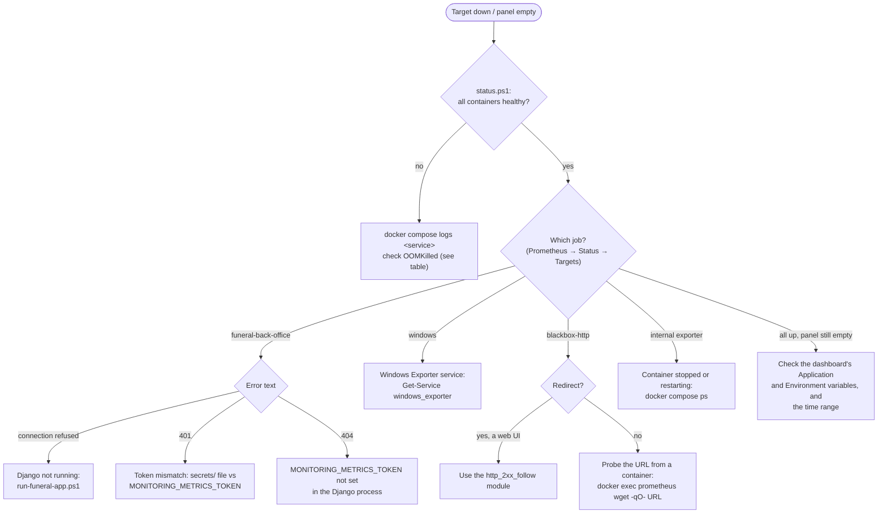
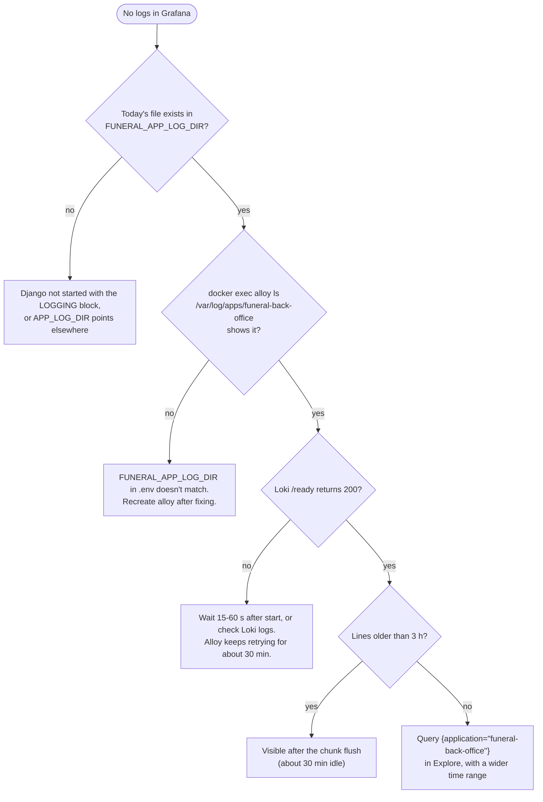
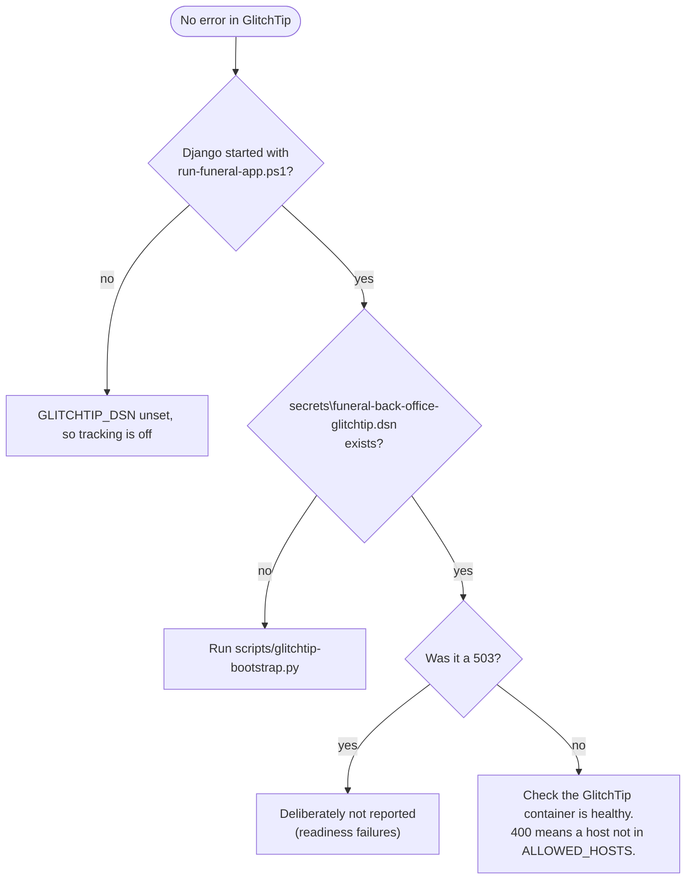

# Troubleshooting

## Triage flowcharts

### A Prometheus target is down, or a dashboard shows no data

### Logs don't appear in Grafana

### Errors don't appear in GlitchTip

## Symptoms and fixes

| Symptom | Likely cause | Fix |
|---|---|---|
| `start.ps1` reports that a port is in use | Another process is listening on 3000, 3001 or 9090 | Find the process with `Get-NetTCPConnection -LocalPort 3000 -State Listen`, then change the port in `.env` or stop that process. |
| Compose error `GRAFANA_ADMIN_PASSWORD must be set` | `.env` is missing or incomplete | Copy `.env.example` to `.env` and set the values. |
| Scripts blocked by the execution policy | Windows policy | Run `powershell -ExecutionPolicy Bypass -File .\scripts\start.ps1`. |
| Grafana shows no data | Prometheus is unhealthy or the data source is wrong | Run `.\scripts\status.ps1`. Check *Connections → Data sources → Prometheus → Test*. |
| A container restarts repeatedly | Bad configuration or a memory limit was hit | Run `docker compose logs <service>` and `docker inspect <service> --format '{{.State.OOMKilled}}'`. |
| A Prometheus config change has no effect | It has not been reloaded | Run `.\scripts\validate.ps1`, then `Invoke-RestMethod -Method Post http://127.0.0.1:9090/-/reload`. |
| A target on the host is `down` with "connection refused" | The app isn't running, or it is unreachable from the container | Check the app is running. From a container, run `docker exec prometheus wget -qO- http://host.docker.internal:8000/health/live/`. |
| Docker Desktop is slow or the host is low on memory | The host has too little free RAM | Close unused applications. You can also cap WSL2 memory in `%UserProfile%\.wslconfig`. |
| Loki shows as unhealthy in `docker compose ps` | Not applicable since Phase 3: Loki has no Docker healthcheck (ADR-018) | Check `Invoke-WebRequest http://127.0.0.1:3100/ready`. Right after a start it returns 503 for 15-60 s while its internal ring comes up. |
| Logs are missing in Grafana or Loki | The app isn't writing daily files, or the mount path is wrong | Check that `logs\funeral-back-office-YYYY-MM-DD.log` exists and that `FUNERAL_APP_LOG_DIR` in `.env` matches. Run `docker exec alloy ls /var/log/apps/funeral-back-office`. A newly created file is picked up within about 30 s. |
| Backdated log lines can't be queried | Loki queries its in-memory ingesters only for the last 3 h | They become visible after the chunk flushes, about 30 min after the stream goes idle |
| No errors appear in GlitchTip | `GLITCHTIP_DSN` isn't set in the Django process | Start the app with `.\scripts\run-funeral-app.ps1`. Check that `secrets\funeral-back-office-glitchtip.dsn` exists. |
| GlitchTip returns 400 Bad Request | Host header not in `ALLOWED_HOSTS` | Use `http://localhost:8001` or `http://127.0.0.1:8001` |
| Docker flags break in PowerShell 5.1 (`flag provided but not defined: -config`) | PowerShell splits unquoted `-a.b=c` arguments at the dot | Quote the argument: `'-config.file=/path'` |
| `windows` target is down | windows_exporter isn't installed or isn't running | Run `.\scripts\install-windows-exporter.ps1`, then `Get-Service windows_exporter` and `Invoke-WebRequest http://127.0.0.1:9182/metrics` |
| A Blackbox probe fails on a web UI | The UI redirects (for example `/` to `/dashboard`) | Use the `http_2xx_follow` module for that target. Health endpoints deliberately don't follow redirects. |
| `BackupStatusMissing` alert | No backup has completed, or `exporters\textfile\monitoring_backup.prom` is missing | Run `.\scripts\backup.ps1`. Check `docker exec node-exporter ls /textfile`. |
| promtool lint error "duplicate rule(s)" | Two recording rules share a name and labels | Give each a distinguishing static label (see ADR-024) |
| `.env` reads are blocked for Claude Code | Ruflo's `.claude/settings.json` denies `Read(./.env)` | This is intended. Put new secrets in `secrets/` files (ADR-026). |
